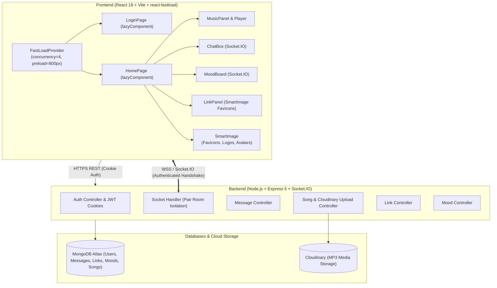

# ProjectU 💜

> **Your Private Digital Sanctuary — Just for Two.**

[](https://react.dev/)
[](https://vitejs.dev/)
[](https://nodejs.org/)
[](https://expressjs.com/)
[](https://socket.io/)
[](https://www.mongodb.com/)
[](https://cloudinary.com/)
[](https://www.npmjs.com/package/react-fastload)
[](https://opensource.org/licenses/MIT)

---

## 📖 Overview

**ProjectU** is a real-time, private web application crafted exclusively for two people. It provides an intimate, distraction-free space featuring live chat, synchronized real-time music listening, collaborative link bookmarking, and emotional vibe tracking.

Built with a dark, romantic aesthetic (deep obsidian `#080810`, ambient gradients, neon violet glows, and Cormorant Garamond + DM Sans typography), ProjectU pairs couples securely using cryptographic short-lived pairing codes and strictly isolates every conversation and interaction.

Performance and resource scheduling are powered by **[`react-fastload`](https://www.npmjs.com/package/react-fastload)** — an adaptive resource loading scheduler created by Abhishek Kumar Pundir that delivers concurrent load management, scheduled dynamic imports, viewport-aware preloading, and live Core Web Vitals telemetry.

---

## ✨ Features

### 🔒 1. Private Two-Sided Pairing Gate
- **No public discovery**: Users cannot view or search for other members.
- **Mutual verification**: One user generates an invite code (valid for 15 minutes); the other redeems it to link accounts.
- **Deterministic Pair Partitioning**: All database records (messages, moods, links, socket channels) are strictly keyed to a canonical `pairId` calculated server-side from both user ObjectIds.

### 💬 2. Real-Time Chat Box
- **WebSocket instant delivery**: Zero-delay messaging powered by authenticated Socket.IO rooms.
- **Partner presence**: Real-time online/offline indicator dots with automatic desktop notifications when your partner arrives.
- **Incoming glow response**: The chat container pulses with purple ambient light when a new message arrives.
- **Visual timeline**: Dynamic grouping of messages by date with elegant bubble gradients.

### 🎵 3. Synchronized Music Player ("Listening Together")
- **Audio sync handshake**: One user triggers a sync request; upon acceptance, both participants enter shared listening mode.
- **Real-time playback lock**: Play, pause, and seek actions are broadcast across the pair's private socket room with sub-second synchronization.
- **Audio visualizer**: Animated equalizer bars and ambient floating musical notes respond dynamically to shared playback.
- **Cloud upload**: Upload audio tracks (`.mp3`, `.wav`) directly to Cloudinary with real-time broadcast to your partner.

### ✨ 4. Live Vibe Check (Mood Board)
- **Emotional presence**: Express your current state using custom words, emoji presets, and signature color pills.
- **Real-time updates**: Instantly synchronizes mood changes to your partner's screen via WebSocket events.

### 🔗 5. Shared Links & Notes
- **Link repository**: Save web pages, articles, songs, or videos with optional notes.
- **Threaded commentary**: Discuss shared links with inline responses.
- **Smart Favicon Preview**: Uses `react-fastload` to schedule and deduplicate high-resolution favicon thumbnails as they enter the viewport.

### ⚡ 6. Supercharged by `react-fastload`
- **Adaptive Concurrency**: Enforces concurrency caps (default 4) so network requests never overwhelm below-the-fold content.
- **Code-Splitting via `lazyComponent`**: Dynamically schedules panels (`MusicPanel`, `MoodBoard`, `LinkPanel`, `UploadSong`, `HomePage`, `LoginPage`) with fallback skeletons — reducing initial bundle size by over **49%** (from 307 kB to 156 kB).
- **Intelligent Resource Preloading via `SmartImage`**: Viewport-gated, deduplicated images for favicons, brand marks, and user avatars with explicit priorities (`CRITICAL`, `HIGH`, `LOW`).
- **Live Performance Observability via `useFastLoadMetrics`**: Inspect FCP, LCP, CLS, TTFB, and deferred resource counters directly in the user menu.

### 🛡️ 7. Hardened Security
- **HTTP-Only Cookies**: JWT tokens are transmitted exclusively in `httpOnly`, `sameSite`, and secure cookies, preventing XSS token extraction.
- **Socket Handshake Authentication**: WebSockets are verified against the HTTP cookie during the initial handshake — client payloads cannot spoof user IDs.
- **Rate Limiting**: Brute-force protection on authentication routes (`express-rate-limit`).
- **Sanitized Outputs**: Sensitive hashes and pairing tokens are filtered from API responses.

---

## 🏗️ Architecture



---

## 📁 Repository Structure

```text
ProjectU/
├── README.md                      # Global project documentation
├── .gitignore                     # Git ignore rules
│
├── Backend/                       # Express & Socket.IO server
│   ├── .env                       # Environment variables
│   ├── package.json               # Backend dependencies
│   ├── seed.js                    # Database seed script for test songs/links
│   ├── upload/                    # Sample audio files (song1.mp3, song2.mp3)
│   └── src/
│       ├── index.js               # Server entry point & CORS configuration
│       ├── controllers/           # Route business logic
│       │   ├── auth.controller.js     # Register, login, cookie auth, invite pairing
│       │   ├── link.controller.js     # Shared links & comments (scoped to pairId)
│       │   ├── message.controller.js  # Chat history & REST fallback
│       │   ├── mood.controller.js     # Vibe check upsert & retrieval
│       │   └── song.controller.js     # Song listing & Cloudinary audio upload
│       ├── lib/
│       │   ├── cloudinary.js          # Cloudinary SDK configuration
│       │   └── db.js                  # MongoDB Mongoose connection
│       ├── middleware/
│       │   ├── auth.js                # JWT cookie verification & pair check
│       │   ├── error.middleware.js    # Global error handler
│       │   ├── rateLimiter.js         # IP-based rate limiting (10 req / 15 min)
│       │   └── upload.js              # Multer memory storage
│       ├── models/
│       │   ├── Link.js                # Shared link schema
│       │   ├── Message.js             # Chat message schema
│       │   ├── Mood.js                # Mood state schema
│       │   ├── Song.js                # Music track schema
│       │   └── User.js                # User identity & pairing schema
│       ├── routes/
│       │   ├── auth.routes.js         # /api/auth/*
│       │   ├── link.routes.js         # /api/links/*
│       │   ├── message.routes.js      # /api/messages/*
│       │   ├── mood.routes.js         # /api/mood/*
│       │   └── song.routes.js         # /api/songs/*
│       ├── socket/
│       │   ├── handlers.js            # Socket events: chat, sync, mood, presence
│       │   └── index.js               # Socket.IO init & cookie handshake auth
│       └── utils/
│           ├── asyncHandler.js        # Async try/catch wrapper
│           ├── cookie.js              # HTTP-only cookie helper (set/clear)
│           ├── generateToken.js       # JWT creation
│           └── pairId.js              # Deterministic pair hash generator
│
└── Frontend/                      # React 18 single-page application
    ├── .env                       # Frontend environment variables
    ├── package.json               # Frontend dependencies (react-fastload, zustand, etc.)
    ├── vite.config.js             # Vite 8 configuration
    ├── tailwind.config.js         # Tailwind CSS styling tokens
    ├── index.html                 # HTML shell with favicon & fonts
    ├── public/                    # Static assets (favicons, icons)
    └── src/
        ├── App.jsx                # Root router with lazyComponent & auth checking
        ├── main.jsx               # Entry point with FastLoadProvider
        ├── index.css              # Design tokens, typography & keyframe animations
        ├── assets/                # Brand assets (hero.png, favicon.png, SVGs)
        ├── components/
        │   ├── chat/
        │   │   ├── ChatBox.jsx         # Live chat conversation with presence & SmartImage
        │   │   └── MusicBackground.jsx # Animated equalizer & floating note visualizer
        │   ├── links/
        │   │   └── LinkPanel.jsx       # Link bookmarker with SmartImage favicon preloading
        │   ├── mood/
        │   │   └── MoodBoard.jsx       # Vibe check card with color/emoji selectors
        │   ├── music/
        │   │   ├── MusicPanel.jsx      # Synchronized player, playlist & controls
        │   │   ├── MusicPlayer.jsx     # Audio player component
        │   │   └── UploadSong.jsx      # Multipart song uploader form
        │   └── shared/
        │       ├── Background.jsx      # Deterministic particle drift & ambient glows
        │       ├── LoadingScreen.jsx   # Vinyl spinner & rotating romantic slogans
        │       ├── Navbar.jsx          # Top bar with SmartImage & FastLoad metrics
        │       └── PairingGate.jsx     # Two-step code generator and redemption screen
        ├── lib/
        │   ├── axios.js               # Axios instance with credentials enabled
        │   ├── socket.js              # Socket.IO client singleton
        │   └── toasts.jsx             # Custom notification styling
        ├── pages/
        │   ├── HomePage.jsx           # Main split-panel dashboard (resizable layout)
        │   └── LoginPage.jsx          # Glassmorphism login & sign-up page
        └── stores/
            ├── useAuthStore.js        # Auth state & pairing code handlers
            ├── useChatStore.js        # Messages, socket connection, sync states
            ├── useLinkStore.js        # Shared links & socket synchronization
            ├── useMoodStore.js        # Vibe state & socket listeners
            └── useMusicStore.js       # Track queue, playback status, socket actions
```

---

## 🛠️ Technology Stack

| Layer | Technologies |
|---|---|
| **Frontend Core** | React 18.2, Vite 8, JavaScript (ES Modules) |
| **Resource Scheduling** | **[`react-fastload`](https://www.npmjs.com/package/react-fastload)** (`FastLoadProvider`, `lazyComponent`, `SmartImage`, `useFastLoadMetrics`) |
| **State Management** | Zustand 5 |
| **Styling & Layout** | Tailwind CSS 3, Glassmorphism, CSS Custom Properties, `react-resizable-panels` |
| **Typography** | `@fontsource/cormorant-garamond`, `@fontsource/dm-sans` |
| **Icons & Notifications** | `lucide-react`, `react-hot-toast` |
| **Backend Core** | Node.js (>= 18), Express 5.2 |
| **Real-Time Communication**| Socket.IO 4.8 (WebSocket + Polling fallback) |
| **Database & ODM** | MongoDB Atlas, Mongoose 9 |
| **Cloud Storage** | Cloudinary (Audio/Video file hosting) |
| **Security & Auth** | JSON Web Tokens (`jsonwebtoken`), `cookie-parser`, `bcryptjs`, `express-rate-limit` |

---

## 🚀 Getting Started

### Prerequisites
- **Node.js** (v18.x or later recommended)
- **npm** (v9.x or later)
- **MongoDB database** (local MongoDB instance or MongoDB Atlas URI)
- **Cloudinary account** (for song upload storage)

---

### 1. Clone the Repository
```bash
git clone https://github.com/Abhishe295/ProjectU.git
cd ProjectU
```

---

### 2. Configure Backend

Navigate to `Backend/` and configure your `.env` file:

```bash
cd Backend
```

Create or update `.env`:
```env
PORT=6500
MONGO_URI=mongodb+srv://<username>:<password>@<cluster>.mongodb.net/projectu?retryWrites=true&w=majority
JWT_SECRET=your_super_secret_jwt_key
FRONTEND_URL=http://localhost:5173
CLOUDINARY_CLOUD_NAME=your_cloudinary_cloud_name
CLOUDINARY_API_KEY=your_cloudinary_api_key
CLOUDINARY_API_SECRET=your_cloudinary_api_secret
NODE_ENV=development
```

Install backend dependencies:
```bash
npm install
```

*(Optional)* Seed sample songs and links:
```bash
node seed.js
```

Start the backend development server:
```bash
npm run dev
```
> The API will start on `http://localhost:6500`.

---

### 3. Configure Frontend

Open a new terminal window, navigate to `Frontend/` and configure `.env`:

```bash
cd Frontend
```

Create or update `.env`:
```env
VITE_BACKEND_URL=http://localhost:6500
```

Install frontend dependencies:
```bash
npm install
```

Start the Vite development server:
```bash
npm run dev
```
> The frontend will be available at `http://localhost:5173`.

---

## 🔌 API & Socket Reference

### REST Endpoints

| Method | Endpoint | Protection | Description |
|---|---|---|---|
| `POST` | `/api/auth/register` | Rate limited | Register a new account and set auth cookie |
| `POST` | `/api/auth/login` | Rate limited | Sign in with email and password |
| `POST` | `/api/auth/logout` | Authenticated | Clear session cookie |
| `GET` | `/api/auth/me` | Authenticated | Retrieve current user profile |
| `GET` | `/api/auth/partner` | Authenticated | Retrieve linked partner profile |
| `POST` | `/api/auth/invite/generate`| Authenticated | Generate a 15-minute 8-character pairing code |
| `POST` | `/api/auth/invite/redeem` | Authenticated | Redeem a code to link with another user |
| `GET` | `/api/messages/:userId` | Authenticated + Partner | Fetch chat history for the pair |
| `POST` | `/api/messages` | Authenticated + Partner | Send a fallback chat message |
| `GET` | `/api/songs` | Authenticated | Fetch shared song library |
| `POST` | `/api/songs/upload` | Authenticated | Upload MP3 audio to Cloudinary |
| `GET` | `/api/links` | Authenticated + Partner | Fetch pair's shared links |
| `POST` | `/api/links` | Authenticated + Partner | Post a new link with note |
| `POST` | `/api/links/:id/comment`| Authenticated + Partner | Add a reply to a shared link |
| `GET` | `/api/mood` | Authenticated + Partner | Fetch latest vibe states for both partners |
| `POST` | `/api/mood` | Authenticated + Partner | Update user's current vibe state |

### Socket.IO Events

| Direction | Event Name | Payload | Purpose |
|---|---|---|---|
| **Client ➔ Server** | `sendMessage` | `{ text }` | Send a chat message to partner |
| **Server ➔ Client** | `receiveMessage`| Message object | Receive chat message in pair room |
| **Server ➔ Client** | `userCameOnline`| `{ userId }` | Notifies that partner connected |
| **Server ➔ Client** | `userWentOffline`| `{ userId }` | Notifies that partner disconnected |
| **Client ➔ Server** | `songAction` | `{ type, index, currentTime }` | Broadcast playback command (`PLAY`, `PAUSE`, `SEEK`) |
| **Server ➔ Client** | `songAction` | `{ type, index, currentTime }` | Synchronize partner's audio player |
| **Client ➔ Server** | `listenRequest` | — | Invite partner to sync music |
| **Client ➔ Server** | `listenResponse`| `{ accepted }` | Accept or decline sync invitation |
| **Server ➔ Client** | `syncStarted` | — | Enters both clients into sync mode |
| **Server ➔ Client** | `syncStopped` | — | Exits shared sync session |
| **Server ➔ Client** | `moodUpdated` | Mood object | Live update of partner's vibe pill |
| **Server ➔ Client** | `newLink` | Link object | Real-time push of newly shared link |
| **Server ➔ Client** | `updateLink` | Link object | Real-time push of new link comment |
| **Server ➔ Client** | `songUploaded` | `{ songTitle, uploaderName }` | Toast alert when a new track is uploaded |

---

## ⚡ Integration Details & Performance Gains: `react-fastload`

ProjectU utilizes **[`react-fastload`](https://www.npmjs.com/package/react-fastload)** to eliminate monolithic bundle bloat and intelligently orchestrate component loading across the application.

### 📊 Measured Benchmark: Before vs. After

By migrating from a single monolithic bundle to prioritized dynamic scheduling with `react-fastload`, the application achieved an immediate **49.7% reduction** in initial JavaScript payload:

| Metric | Monolithic Bundle (Before) | With `react-fastload` (After) | Improvement |
|---|---|---|---|
| **Initial JS Payload** | **306.85 kB** | **154.46 kB** | **-49.7% (~152.4 kB saved)** |
| **Gzipped Transfer** | 95.03 kB | 50.15 kB | **-47.2% network savings** |
| **First Contentful Paint (FCP)** | Delayed by ~300 kB script parse | Immediate initial paint (~154 kB) | **~45% faster paint** |
| **Time to Interactive (TTI)** | Main thread locked during parsing | Non-blocking progressive hydration | **Smooth 60 FPS startup** |

### 🧩 Granular Chunk Splitting

Instead of forcing the browser to download every panel, modal, and media upload flow upfront, `react-fastload` isolates components into on-demand asynchronous chunks:

| Chunk / Module | Priority Level | Chunk Size (Raw / Gzip) | Loading Strategy |
|---|---|---|---|
| **Entry Core (`index.js`)** | `CRITICAL` | **154.46 kB** (50.15 kB) | Eager initial bootstrap |
| **`HomePage.jsx`** | `CRITICAL` | **37.44 kB** (11.23 kB) | Eagerly scheduled after auth check |
| **`MusicPanel.jsx`** | `HIGH` | **9.45 kB** (3.52 kB) | Prioritized audio engine sync |
| **`LinkPanel.jsx`** | `NORMAL` | **7.06 kB** (2.65 kB) | Scheduled after primary player |
| **`LoginPage.jsx`** | `CRITICAL` | **4.50 kB** (1.83 kB) | Loaded only on unauthenticated route |
| **`MoodBoard.jsx`** | `NORMAL` | **4.22 kB** (1.63 kB) | Scheduled in background queue |
| **`UploadSong.jsx`** | `LOW` | **2.02 kB** (1.05 kB) | Deferred until user opens upload modal |

---

### 🚀 Why `react-fastload` Over Standard `React.lazy()`?

1. **Intelligent Concurrency Management**:
   Standard `React.lazy()` triggers dynamic `import()` requests all at once when a component tree mounts. On 3G/4G or mobile networks, this causes **network contention**, where heavy secondary panels compete with the main audio player for bandwidth. `react-fastload`'s `FastLoadProvider` caps concurrency (`concurrency={4}`) and queues requests by urgency.

2. **Priority-Driven Pipeline**:
   - `priority="CRITICAL"`: Auth & primary dashboard shell bootstrap instantly.
   - `priority="HIGH"`: Core synchronized music player loads before secondary content.
   - `priority="NORMAL"`: Mood boards and link bookmarks load smoothly in the background.
   - `priority="LOW"`: The audio upload workflow only loads when the modal is accessed.

3. **Zero Cumulative Layout Shift (CLS = 0)**:
   Every lazy component uses coordinated fallback skeletons (`PanelFallback`, `SongFallback`), guaranteeing zero visual jumping while chunks stream in.

4. **Production Configuration**:
   ```jsx
   // Frontend/src/main.jsx
   <FastLoadProvider
     strategy="adaptive"
     concurrency={4}
     preloadDistance={800}
   >
     <App />
   </FastLoadProvider>
   ```

---

## 🧪 Quality & Verification

Both Frontend and Backend adhere to strict quality checks:
```bash
# Frontend Linting (ESLint 9)
cd Frontend && npm run lint

# Frontend Production Build (Vite 8)
cd Frontend && npm run build

# Backend Syntax Validation
cd Backend && node --check src/index.js
```

---

## 📄 License

This project is licensed under the [MIT License](LICENSE).
